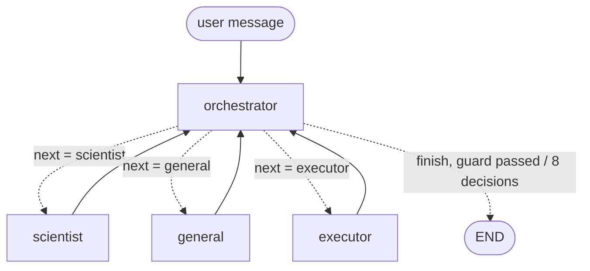

# agentic-ode-system

A four-role LangGraph system (orchestrator, scientist, general agent, executor) that is given Task 5, the neural-ODE fit of the Silverbox oscillator, and tries to solve it. The system spec is in [task6.md](task6.md), and the problem the system receives is in [task5.md](task5.md).

## Graph



- **State** ([agentic_ode/state.py](agentic_ode/state.py)): the dialogue is a list of turns `{"role", "content"}`, appended with `Annotated[list, operator.add]`. The state also holds a counter of orchestrator decisions, plus the records of real script runs (exit code, stdout, the parsed RMSE) that the finish guard checks.
- **Orchestrator** ([agents/orchestrator.py](agentic_ode/agents/orchestrator.py)): one model call per turn, with structured output `Decision(next, instruction, reason)`. The decision is appended to the dialogue as its turn. It has no tools and follows no keyword table or fixed order. The routing prompt sends plan and ODE questions to the scientist, tracebacks to the executor, and conceptual side questions to the general agent.
- **Finish guard** (`finish_allowed`): `finish` is accepted only when an executor turn contains a `FREE_RUN_TEST_RMSE:` line from the stdout of a run that exited with code 0. Otherwise the model is asked again, with a note that finish is not yet allowed (up to 3 times). The run stops on finish, or after 8 decisions.
- **Scientist** and **general agent** ([agents/specialists.py](agentic_ode/agents/specialists.py)): no tools. The scientist writes the ODE, the network, the state equation, the training, the free-run test and numbered steps. The general agent answers side questions only.
- **Executor** ([agents/executor.py](agentic_ode/agents/executor.py), [tools/](agentic_ode/tools/)): the only node bound to tools. `write_file` writes a new file into `runs/<timestamp>/` and never overwrites one. `run_file` runs the file with a 300 s timeout. The executor runs an internal tool loop (at most 2 script runs per turn), then appends one turn with the real tool output verbatim.

## Install

```bash
python3 -m venv .venv
.venv/bin/pip install -e '.[dev]'               # or: pip install -r requirements.txt
cp ../silverbox-pinn/data/SNLS80mV.mat data/   # or download SNLS80mV.mat from nonlinearbenchmark.org
```

`.env` (not committed):

```
OPEN_ROUTER_API_KEY=...        # or OPENROUTER_API_KEY; without it, init_chat_model uses MODEL's own provider
MODEL=nvidia/nemotron-3-super-120b-a12b:free
# optional: AGENTIC_ODE_DATA_FILE=..., AGENTIC_ODE_RUNS_DIR=..., OPENROUTER_BASE_URL=...
```

All limits (8 decisions, 300 s per script, tool rounds, output clipping, retries) live in one place: `Settings` in [agentic_ode/config.py](agentic_ode/config.py).

## Run

```bash
agentic-ode run                          # sends task5.md to the orchestrator, prints "[role] text" per turn
agentic-ode -v run other_task.md         # any task file; -v logs decisions, -vv also tool calls
agentic-ode report runs/<timestamp>      # report/solution.pdf from transcript.json (needs Chrome/Chromium)
python main.py                           # same as `agentic-ode run`
python -m agentic_ode run                # same, without the console script
```

From Python:

```python
from pathlib import Path
from agentic_ode import Settings, run_task

outcome = run_task(Path("task5.md"), Settings.from_env(), on_turn=print)
print(outcome.run_dir, outcome.state["stop_reason"])
```

Each run writes `runs/<timestamp>/` with the executor's scripts, `transcript.json` (the dialogue plus run records) and `transcript.md`. Only the run used in the report is committed.

## Development

```bash
.venv/bin/pytest -q          # offline, with a scripted fake model: tools, finish guard, 8-decision limit,
                             # tool ownership, runner transcripts, report numbers taken verbatim
.venv/bin/ruff check .
```

## Layout

```
agentic_ode/
  config.py            Settings: model access, paths, all limits (loaded from env / .env)
  llm.py               chat model factory, retries, message helpers
  state.py             Role, Turn, RunRecord, DialogueState (dialogue + decision counter + run records)
  graph.py             StateGraph wiring
  runner.py            run_task(): run directory, streaming, transcript after every step
  transcript.py        transcript.json / transcript.md
  cli.py, __main__.py  `agentic-ode run | report`
  agents/
    prompts.py         system prompts of the four roles
    context.py         what a specialist sees: dialogue + orchestrator instruction
    orchestrator.py    Decision, finish guard, Orchestrator node
    specialists.py     scientist and general agent (no tools)
    executor.py        executor node: internal tool loop, one verbatim turn
  tools/
    workspace.py       write_file / run_file (sandboxed names, timeout)
    metrics.py         FREE_RUN_*_RMSE output contract
    __init__.py        LangChain tool wrappers bound to the executor
  reporting/
    builder.py         report HTML + PDF from transcript.json
    diagram.py         graph drawing and Mermaid source
tests/                 offline tests (conftest.py holds the fake model)
runs/<timestamp>/      the committed validation run
report/                solution.pdf, solution.html, graph.mmd
main.py                thin entry point (= agentic-ode run)
```
