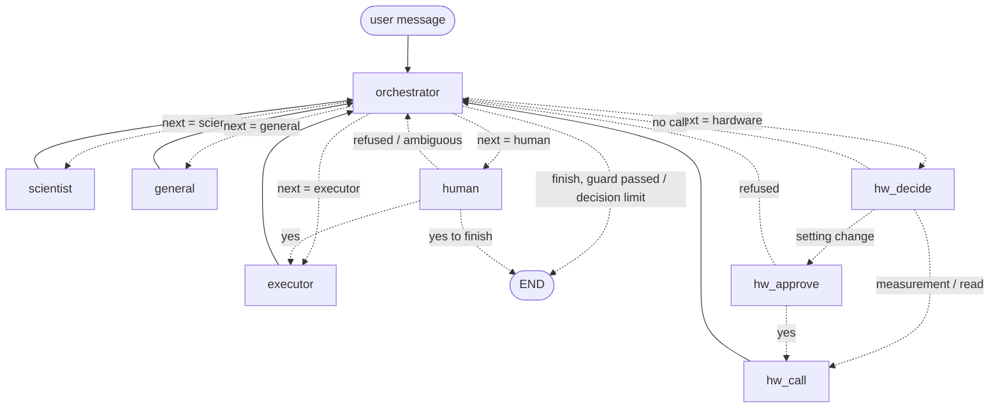

# agentic-ode-system

A LangGraph system with four model roles (orchestrator, scientist, general agent, executor), a human pause and a
hardware turn. It was first given Task 5, the neural-ODE fit of the Silverbox oscillator (spec in
[task6.md](task6.md), problem in [task5.md](task5.md)). Later it also ran focusing experiments on a simulated optical
bench (HW2), and it drives an IDS event camera through an MCP server (HW3). The full map of the code is in
[docs/architecture.md](docs/architecture.md).

## Graph



- **State** ([core/state.py](agentic_ode/core/state.py), [core/records.py](agentic_ode/core/records.py)): the dialogue is a list of turns `{"role", "content"}`, appended with `Annotated[list, operator.add]`. The state also holds a counter of orchestrator decisions and the records of real tool calls (script runs, focusing experiments, camera calls) that the finish guard checks.
- **Orchestrator** ([agents/orchestrator.py](agentic_ode/agents/orchestrator.py)): one model call per turn, with structured output `Decision(next, instruction, reason, ...)`. The decision is appended to the dialogue as its turn. It has no tools.
- **Finish guard** ([agents/guards.py](agentic_ode/agents/guards.py), `finish_allowed`): `finish` is accepted only when real evidence is in the dialogue: an executor turn with a `FREE_RUN_TEST_RMSE:` line from a run that exited with code 0, a `FOCUS_ENHANCEMENT` line from a real focusing call, or a hardware turn with a successful camera measurement. Otherwise the model is asked again (up to 3 times). The run stops on finish or at the decision limit (8, or 20 for camera runs).
- **Scientist** and **general agent** ([agents/specialists.py](agentic_ode/agents/specialists.py)): no tools. The scientist writes the plan; the general agent answers side questions only.
- **Executor** ([agents/executor.py](agentic_ode/agents/executor.py), [tools/](agentic_ode/tools/)): the only role bound to tools. `write_file` writes a new file into `runs/<timestamp>/` and never overwrites one. `run_file` runs it with a 300 s timeout. `run_focus_search` runs one focusing experiment on the simulated bench.
- **Human** ([graph/nodes/human_turn.py](agentic_ode/graph/nodes/human_turn.py)): the graph pauses with `interrupt()`. One "yes" approves exactly one hard step.
- **Hardware turn** ([graph/nodes/hardware_turn.py](agentic_ode/graph/nodes/hardware_turn.py)): the executor's model picks ONE camera tool call; a setting change waits for the human's approval; the call runs through the MCP session and its result goes verbatim into the dialogue.
- **Event camera** ([hardware/devices/evcam/](agentic_ode/hardware/devices/evcam/), [mcp/](agentic_ode/mcp/)): `EvcamInstrument` exposes 10 actions; the generic server factory turns it into an MCP server. See "Model Hardware Standard" in [docs/architecture.md](docs/architecture.md) for how to add another instrument.

## Install

```bash
python3 -m venv .venv
.venv/bin/pip install -e '.[dev]'               # or: pip install -r requirements.txt
cp ../silverbox-pinn/data/SNLS80mV.mat data/   # or download SNLS80mV.mat from nonlinearbenchmark.org
```

`.env` (not committed):

```
OPEN_ROUTER_API_KEY=...        # or OPENROUTER_API_KEY; without it, init_chat_model uses MODEL's own provider
MODEL=nvidia/nemotron-3-super-120b-a12b:free
# optional: AGENTIC_ODE_DATA_FILE=..., AGENTIC_ODE_RUNS_DIR=..., OPENROUTER_BASE_URL=...
```

All limits (decisions, 300 s per script, tool rounds, output clipping, retries) live in one place: `Settings` in [agentic_ode/core/config.py](agentic_ode/core/config.py).

The real event camera needs the Metavision SDK and the shell alias `evcam` (see [docs/hw3-hardware.md](docs/hw3-hardware.md)). Without a camera, set `EVCAM_FAKE=1` to use the fake camera.

## Run

```bash
agentic-ode run                          # sends task5.md to the orchestrator, prints "[role] text" per turn
agentic-ode -v run other_task.md         # any task file; -v logs decisions, -vv also tool calls
agentic-ode run tasks/uc2_flicker.md --camera            # with the event camera (MCP server as a subprocess)
EVCAM_FAKE=1 agentic-ode run tasks/uc2_flicker.md --camera --auto-approve   # fake camera, approvals answered "yes"
agentic-ode report runs/<timestamp>      # report/solution.pdf from transcript.json (needs Chrome/Chromium)
python main.py                           # same as `agentic-ode run`
python -m agentic_ode run                # same, without the console script
```

The camera MCP server on its own (stdio):

```bash
EVCAM_FAKE=1 python -m agentic_ode.mcp_servers.evcam_server    # the evcam server (EVCAM_FAKE_SCENE=dark|pwm|steady)
EVCAM_FAKE=1 python -m agentic_ode.mcp.serve evcam             # the same tools, through the generic entry point
python scripts/mcp_smoke.py --stdio                            # call the tools through our MCP client
```

From Python:

```python
from pathlib import Path
from agentic_ode import Settings, run_task

outcome = run_task(Path("task5.md"), Settings.from_env(), on_turn=print)
print(outcome.run_dir, outcome.state["stop_reason"])
```

Each run writes `runs/<timestamp>/` with the executor's scripts, `transcript.json` (the dialogue plus run records) and `transcript.md`. Camera recordings and the tool log go to `runs/evcam/`. Only the run used in the report is committed.

## EventLab (web app)

EventLab is a browser front end for the same system: it starts a camera run of the existing graph, shows every
turn and every camera call as it happens, asks the operator for approvals, and shows the measurements and a report.
It adds no second agent and no second path to the camera:

```
browser (React, web/) --HTTP + Server-Sent Events--> FastAPI (agentic_ode/web/, 127.0.0.1 only)
    --> run_task(camera=True) --> the graph (unchanged) --> MCP client --> evcam MCP server --> camera or fake camera
```

- One experiment at a time: it owns the camera (the same lock as "Check camera"); a second one gets 409.
- Approve / Reject answer the graph's own question (`hw_approve` or the human node) with exactly "yes" / "no";
  the API never calls a camera tool itself. Other questions get a free-text answer.
- Status updates never open the camera. Only the "Check camera" button does (one `camera_info` call, ~10 s on the
  real camera), and never automatically.
- Plots come from the SAVED recordings (`runs/evcam/<id>.npz`), labelled with recording id, duration and time; there
  is no live event stream. The spectrum chart shows the detected peaks only (what the `spectrum` tool returns).
- Every experiment is saved in `runs/<id>/`: `experiment.json` (summary + CameraRecords), `events.jsonl` (every
  event), `task.md`, and the usual `transcript.json` / `transcript.md`. The report is built from these files only.
- Real or simulated is fixed when the backend starts (`EVCAM_FAKE`); every panel and the report show it.
- No login: keep both servers on 127.0.0.1. Put authentication in front before any remote use.

Install (once). The camera venv `~/mv-venv` is the environment that works with the SDK and the tests:

```bash
~/mv-venv/bin/python -m pip install -e '.[web]'      # FastAPI (uvicorn is already there)
cd web && npm install --ignore-scripts               # React, Vite, TypeScript (exact versions, package-lock.json)
```

Run with the **fake camera** (two terminals; the model comes from `.env`, each experiment uses model requests):

```bash
# terminal 1: the API on http://127.0.0.1:8000 (EVCAM_FAKE_SCENE=dark|pwm|steady, default pwm = 240 Hz)
cd ~/Projects/agentic-ode-system && EVCAM_FAKE=1 ~/mv-venv/bin/python -m agentic_ode.web
# terminal 2: the web app on http://127.0.0.1:5173 (it forwards /api to port 8000)
cd ~/Projects/agentic-ode-system/web && npm run dev
```

Run with the **real camera**:

```bash
# terminal 1: in the evcam shell (sets the SDK paths); close metavision_viewer and any CLI camera run first
evcam
cd ~/Projects/agentic-ode-system && unset EVCAM_FAKE && python -m agentic_ode.web
# terminal 2: the same as above
cd ~/Projects/agentic-ode-system/web && npm run dev
```

Open http://127.0.0.1:5173. A link `#/experiments/<id>` opens one experiment; the History panel lists all of them.

Tests and checks:

```bash
~/mv-venv/bin/python -m pytest -q -p no:cacheprovider   # all Python tests, incl. tests/test_web_*.py (fake model,
                                                        # fake camera in memory; no hardware, no API calls)
cd web && npm test                                      # the pure frontend logic (node --test, no extra packages)
cd web && npm run typecheck && npm run build            # TypeScript check and production build
```

### Real-camera checklist

1. Close `metavision_viewer` and every other camera program (only one process can open the camera).
2. Start terminal 1 as above **in the `evcam` shell**, without `EVCAM_FAKE`. Start terminal 2.
3. In the browser, the header shows **Real hardware mode**, the Camera panel **REAL HARDWARE**, and the SDK
   **found**. If the SDK is "not found", the backend was not started in the `evcam` shell: stop it and start again.
4. Click **Check camera** once (~10–12 s). Expect serial 4110039066, sensor IMX636, 1280 × 720, source
   **physical camera**. The camera is released after the check.
5. Hold the phone screen in front of the sensor (no lens: it sees the total light change). Choose the example
   **Flicker frequency** and click **Start experiment**.
6. When the first `record` warns about pixels above 20 kHz, the model should ask for `mask_pixels`. **Approve only
   the pixels that the warning lists** (usually (1053, 704) and (926, 151); after a fresh open they can show up on
   one pixel, see docs/hw3-hardware.md). Reject any other setting change you did not expect.
7. If the model asks to write an analysis script, you may answer **no** and, at its next question, point it to the
   `spectrum` tool (the first real-model run did exactly this).
8. Check the result: the Measurements panel and the Report show **REAL CAMERA DATA**, the recording ids, the
   fundamental with ± resolution and its SNR. A phone screen showed ~240 Hz before; a new run may differ.
9. Compare the report's procedure table with the server log:
   `tail -n 20 runs/evcam/tool_log.jsonl`: the same tools, the same arguments, the same `ok` values and recording
   ids; each recording file exists: `ls runs/evcam/<recording id>.npz`.
10. Afterwards the Camera panel shows the owner **free**; the CLI (`agentic-ode run --camera`) can use the camera
    again while no web experiment runs.

## Development

```bash
.venv/bin/pytest -q          # offline, with a scripted fake model and the fake camera; includes snapshot tests
                             # (tests/snapshots/) that pin the MCP tools, the graph, the prompts and tool results
.venv/bin/ruff check .
```

## Layout

```
agentic_ode/
  core/            settings, state and records, dialogue text, RMSE contract, chat model
  agents/          the four model roles, their prompts and the guards
  tools/           the executor's in-process tools (write_file, run_file, run_focus_search)
  graph/           the StateGraph: builder, routing, nodes/human_turn.py, nodes/hardware_turn.py
  hardware/
    standard/      Model Hardware Standard: Instrument, ActionSpec, Result, registry
    devices/       evcam/ (driver, fake, limits, analysis, store, instrument), optical_bench/ (simulator)
  mcp/             MCP client, generic server factory, serve.py, evcam_server.py
  mcp_servers/     evcam_server.py: the documented server command (alias of mcp/evcam_server.py)
  runtime/         cli (agentic-ode run | report), runner, run_store (transcripts)
  reporting/       report HTML + PDF, graph drawing
  web/             EventLab API (FastAPI): app.py, experiments.py (one-at-a-time runs), events.py, recordings.py
web/               EventLab browser app (React + TypeScript + Vite, plain CSS); tests/ run with node --test
tests/             offline tests (conftest.py holds the fake model; snapshots/ the pinned behaviour)
scripts/           camera capture and analysis, HW3 figures, MCP smoke test
docs/              architecture.md (this layout), refactor-plan.md, hardware notes
runs/<timestamp>/  the committed validation run
report/            solution.pdf, solution.html, graph.mmd
main.py            thin entry point (= agentic-ode run)
```
