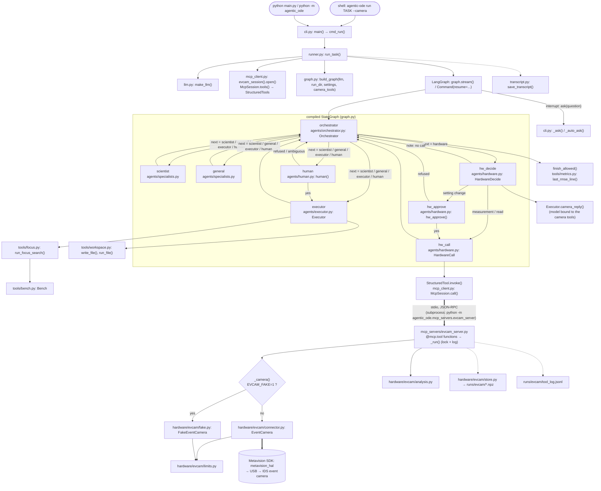

# Architecture: the code as it is now (before the refactor)

This is a map of branch `refactor/structure` at commit `7b16615`, before any refactor change.
It describes the code; it does not change it. Line numbers are for this commit.

## 1. Modules

"Imports" lists only modules from inside this project. One Python fact matters for the whole table: importing
any `agentic_ode.x.y` first runs `agentic_ode/__init__.py`, and that file imports `graph` and `runner`. So any
import of the package loads almost the whole package (see confusing spot A1).

### Entry points

| Module | What it does | Imports (inside the project) |
|---|---|---|
| `pyproject.toml` `[project.scripts]` | Makes the shell command `agentic-ode` call `agentic_ode.cli:main`. | `cli` |
| `main.py` | Runs `cli.main(["run", ...])`, so `python main.py [TASK]` is the same as `agentic-ode run [TASK]`. | `cli` |
| `agentic_ode/__main__.py` | Runs `cli.main()` for `python -m agentic_ode ...`. | `cli` |
| `agentic_ode/cli.py` | Parses the `run` and `report` commands, prints turns, and asks the person (or auto-approves) when the graph pauses. | `config`, `llm`, `state`; inside functions: `runner` (in `cmd_run`), `reporting` (in `cmd_report`) |

### Core

| Module | What it does | Imports (inside the project) |
|---|---|---|
| `agentic_ode/__init__.py` | Package front door: re-exports `Settings`, `build_graph`, `run_task`, `RunOutcome`, `__version__`. | `config`, `graph`, `runner` |
| `agentic_ode/config.py` | `Settings` dataclass (model, paths, limits), read from the environment and `.env`; also `PROJECT_ROOT`. | — |
| `agentic_ode/state.py` | The graph state types (`DialogueState`, `Turn`, run/experiment/camera records), the `Role` names, the camera tool groups, and `render_dialogue()`. | — |
| `agentic_ode/llm.py` | Builds the chat model (`make_llm`), adds retries (`with_retry`), and gets plain text from a message (`text_of`). | `config` |
| `agentic_ode/runner.py` | `run_task()`: makes a run folder, opens the camera MCP session if `camera=True`, builds and streams the graph, resumes it after each human pause, and saves the transcript. | `config`, `graph`, `llm`, `mcp_client`, `state`, `transcript` |
| `agentic_ode/graph.py` | `build_graph()`: adds the 8 nodes and their edges to a LangGraph `StateGraph` and compiles it with an in-memory checkpointer. | `agents`, `agents.hardware`, `config`, `state` |
| `agentic_ode/transcript.py` | Writes `transcript.json` and `transcript.md` into a run folder and reads the JSON back. | `state` |
| `agentic_ode/mcp_client.py` | `McpSession`: one MCP server subprocess (stdio) with one session in a background thread; gives its tools as LangChain `StructuredTool`s. `evcam_session()` starts the camera server. | — |

### Agents (graph nodes)

| Module | What it does | Imports (inside the project) |
|---|---|---|
| `agentic_ode/agents/__init__.py` | Re-exports the node classes and functions used by `graph.py`. | `agents.executor`, `agents.human`, `agents.orchestrator`, `agents.specialists` |
| `agentic_ode/agents/prompts.py` | The system prompt text of every role, built from `Settings`. | `config` |
| `agentic_ode/agents/context.py` | Builds the messages a specialist sees (whole dialogue + latest instruction) and reads `key: value` lines from an orchestrator turn. | `state` |
| `agentic_ode/agents/orchestrator.py` | The orchestrator node (one structured `Decision` per turn) and the finish guard `finish_allowed()`. | `agents.prompts`, `config`, `llm`, `state`, `tools` |
| `agentic_ode/agents/specialists.py` | `TextSpecialist`: the scientist and general nodes, one plain model call each. | `agents.prompts`, `agents.context`, `config`, `llm`, `state` |
| `agentic_ode/agents/executor.py` | The executor node: a tool loop over `write_file`, `run_file` and `run_focus_search`. It also holds the model bound to the camera tools, which the hardware nodes use. | `agents.prompts`, `agents.context`, `config`, `llm`, `state`, `tools` |
| `agentic_ode/agents/human.py` | The human node: pauses with `interrupt()`, adds the reply, and routes on yes/no. | `agents.context`, `agents.orchestrator`, `state` |
| `agentic_ode/agents/hardware.py` | The three hardware-turn nodes: `hw_decide` (the model picks one camera call), `hw_approve` (the human approves a setting change), `hw_call` (runs it through MCP). | `agents.prompts`, `agents.context`, `agents.executor`, `agents.human`, `config`, `llm`, `state` |

### Executor tools (coding tool and simulated optical bench)

| Module | What it does | Imports (inside the project) |
|---|---|---|
| `agentic_ode/tools/__init__.py` | Tool names, `make_executor_tools()` (LangChain tool schemas), and re-exports of the functions below. | `tools.focus`, `tools.metrics`, `tools.workspace` |
| `agentic_ode/tools/workspace.py` | `write_file` (new files only) and `run_file` (subprocess with a time limit) inside the run folder. | — |
| `agentic_ode/tools/metrics.py` | The output contract: regexes that read `FREE_RUN_TRAIN/TEST_RMSE:` lines from stdout. | — |
| `agentic_ode/tools/focus.py` | `run_focus_search()`: random flip search for a focus on the simulated bench; saves PNGs, JSON and a CSV row. | `tools.bench` |
| `agentic_ode/tools/bench.py` | Physics simulator: DMD, fixed scattering medium (transmission matrix), noisy camera, and the enhancement metric. | — |

### Report

| Module | What it does | Imports (inside the project) |
|---|---|---|
| `agentic_ode/reporting/__init__.py` | Re-exports `build_report` and `ReportError`. | `reporting.builder` |
| `agentic_ode/reporting/builder.py` | Builds `solution.html` and `solution.pdf` (with headless Chrome) from a run's `transcript.json`. | `agents.context`, `config`, `reporting.diagram`, `state`, `tools`, `transcript` |
| `agentic_ode/reporting/diagram.py` | Compiles the graph with a dummy model and draws it as a PNG (matplotlib); also returns its Mermaid text. | `graph` |

### Event camera (HW3)

| Module | What it does | Imports (inside the project) |
|---|---|---|
| `agentic_ode/mcp_servers/__init__.py` | Package marker (docstring only). | — |
| `agentic_ode/mcp_servers/evcam_server.py` | FastMCP server with 10 camera tools. It keeps one camera object, uses a lock, logs every call to `tool_log.jsonl`, and picks the fake camera when `EVCAM_FAKE=1`. | `hardware.evcam.analysis`, `hardware.evcam.store`, `hardware.evcam.connector`, `hardware.evcam.fake` |
| `agentic_ode/hardware/__init__.py` | Package marker (docstring only). | — |
| `agentic_ode/hardware/evcam/__init__.py` | Empty package marker. | — |
| `agentic_ode/hardware/evcam/limits.py` | Safety limits and checks (bias range, record length, pixel, ROI), plus sensor size and `WARMUP_S`. | — |
| `agentic_ode/hardware/evcam/connector.py` | `EventCamera`: the real camera through the Metavision SDK (open with settle, biases, mask, ROI, record). The SDK is imported inside `open()`. Also defines `EVENT_DTYPE`. | `hardware.evcam.limits` |
| `agentic_ode/hardware/evcam/fake.py` | `FakeEventCamera`: the same methods as `EventCamera`, with made-up events (scenes dark / pwm / steady). | `hardware.evcam.limits`, `hardware.evcam.connector` (for `EVENT_DTYPE`) |
| `agentic_ode/hardware/evcam/store.py` | Saves and loads one `.npz` file per recording in `runs/evcam/`, with a safe recording id. | `config`, `hardware.evcam.connector` (for `EVENT_DTYPE`) |
| `agentic_ode/hardware/evcam/analysis.py` | Pure numpy: event summary, hot pixels, and the flicker spectrum with fundamental and harmonics. | `hardware.evcam.limits` |

Outside the package (not part of `agentic-ode run`): `scripts/evcam_capture.py` (connector, limits),
`scripts/evcam_analyze.py` (analysis), `scripts/make_hw3_figures.py` (config, analysis, limits, store),
`scripts/mcp_smoke.py` (mcp_client, evcam_server).

## 2. Who calls whom: `agentic-ode run --camera` down to the camera

Solid arrow = function call in the same process. Thick arrow = crosses a process boundary.
Dotted arrow = reads or writes files.

The `agentic-ode report RUN_DIR` path is not drawn: `cli.cmd_report()` → `reporting/builder.py: build_report()`
→ `transcript.load_transcript()` and `reporting/diagram.py: graph_png()` → `graph.build_graph()` (with a dummy model).

## 3. Confusing spots (listed only, not fixed)

### A. Circular or surprising imports

- **A1. The package `__init__` loads everything.** `agentic_ode/__init__.py:3-5` imports `graph` and `runner`. So
  any import of a submodule also loads `graph`, `runner`, `agents`, `llm`, `mcp_client`, LangGraph and LangChain.
  - I checked: the MCP server subprocess (`python -m agentic_ode.mcp_servers.evcam_server`) loads all of
    `agentic_ode.agents.*`, `graph`, `runner`, LangGraph and LangChain, but it uses none of them.
  - `hardware/evcam/store.py:16` imports only `PROJECT_ROOT` from `config`, but that also triggers A1.
  - The "lazy" import `from agentic_ode.runner import run_task` inside `cli.py:51` does nothing: `runner` is
    already loaded by `agentic_ode/__init__.py:5`. (The lazy import of `reporting` at `cli.py:67` does work.)
- **A2. Agent submodules import from their own half-loaded package.** `orchestrator.py:11`, `executor.py:11`,
  `hardware.py:17` and `specialists.py:8` do `from agentic_ode.agents import prompts` while
  `agents/__init__.py` is still running. This works only because `prompts` is a submodule. A name defined in
  `agents/__init__.py` itself would fail with a circular-import error.
- **A3. Nodes import other nodes.** `human.py:8` imports `FINISH` and `finish_allowed` from `orchestrator.py`.
  `hardware.py:19-20` imports `Executor` from `executor.py` and `accepted` from `human.py`. So the guard and the
  yes/no rule live inside node modules.
- **A4. The data format lives in the real driver.** `fake.py:19` and `store.py:17` import `EVENT_DTYPE` from
  `connector.py`, the SDK driver. This works only because `connector.py` imports the SDK inside `open()`.
- **A5. The report depends on the agents and the graph.** `reporting/builder.py:15` imports `decision_field`
  from `agents/context.py` to parse orchestrator text. `reporting/diagram.py:14` compiles the whole graph
  (with a dummy model, `diagram.py:27-34`) only to draw it.
- **A6. The finish guard depends on the tools package.** `orchestrator.py:15` imports `last_rmse_line` from
  `agentic_ode.tools`. `tools/__init__.py` also loads `focus.py` and `bench.py` (numpy simulator), so the
  orchestrator loads the optical-bench simulator.

### B. Modules that do two (or more) jobs

- **B1. `state.py`** holds the state types and also:
  - text rendering: `role_label()` `:32`, `render_dialogue()` `:105`;
  - camera policy: which tools need approval and which count as a measurement (`CAMERA_SETTING_TOOLS`,
    `CAMERA_MEASUREMENT_TOOLS` `:28-29`).
- **B2. `agents/executor.py`** is the coding/focus tool loop, but it also owns the camera model bindings and
  `camera_reply()` (`:64-91`). Only `agents/hardware.py` uses them. Its docstring (`:1`) mentions only the coding
  and focusing tools.
- **B3. `agents/orchestrator.py`** is the orchestrator node and also the finish guard `finish_allowed()`
  (`:51-82`). The guard checks three kinds of proof (camera, focus, RMSE), and `human.py` uses it too.
- **B4. `mcp_servers/evcam_server.py`** has four jobs:
  - the MCP tool definitions;
  - the camera lifetime (global `_cam`, `:35-57`);
  - JSONL logging (`:60-65`);
  - measurement logic: recording metadata and the three warnings in `record()` (`:168-208`).
- **B5. `tools/` package** mixes the executor's tools (`workspace.py`, `focus.py`) with a physics simulator
  (`bench.py`) and the RMSE output contract (`metrics.py`). The guard and the report use `metrics.py`, not the
  executor. The camera tools are not in `tools/` at all.
- **B6. `reporting/builder.py`** builds the HTML, prints the PDF through Chrome, and reads the git remote URL
  (`repo_url()` `:29-36`).

### C. Duplicated code

- **C1. `_note()` is the same in two files:** `human.py:55-57` and `hardware.py:59-61`. `_back()` is almost the
  same: `human.py:60-62` and `hardware.py:64-66`.
- **C2. "Find the last orchestrator turn" is written twice:** `human.py:15-19` (`last_orchestrator_turn`) and
  `context.py:18-22` (`latest_instruction`).
- **C3. `EventCamera` and `FakeEventCamera` repeat code.** They have no shared base class or Protocol; "same
  interface" is only a convention:
  - `reapply()`: `connector.py:313-324` = `fake.py:248-259` (word for word);
  - the `mask_pixels()` checks: `connector.py:199-206` = `fake.py:142-149`;
  - the recommended-range check in `set_bias()`: `connector.py:179-181` ≈ `fake.py:125-127`;
  - `__enter__`, `__exit__` and `_require_open()`.
- **C4. The 20 kHz hot-pixel limit is in five places:** `connector.py:24` (`MAX_PIXEL_RATE`), `analysis.py:56`
  (default `min_rate_hz`), `evcam_server.py:123` (default `min_rate_hz`), `evcam_server.py:203` (warning text)
  and `fake.py:25` (comment).
- **C5. 64 mask slots:** `limits.MAX_MASK_SLOTS` (`limits.py:15`) exists, but `64` is written out again at
  `evcam_server.py:123` (`top=64`), `evcam_server.py:137` (`"slots_total": 64`) and `analysis.py:56` (`top=64`).
- **C6. Camera tool names are typed by hand in several places** and must match `evcam_server.py` by hand:
  `prompts.py:18-19`, `prompts.py:155` and `state.py:28-29`.
- **C7. Executor tool descriptions exist twice:** the tool docstrings in `tools/__init__.py:26-53` and the prompt
  text in `prompts.py:168-172` and `prompts.py:97-108` (`bench()`).
- **C8. Two run entry points:** `main.py` (always `run`) and `agentic_ode/__main__.py` (any command).

### D. Misleading names or text

- **D1. "hardware" is a role and a route, but not a node.** It is a `Role` (`state.py:20`) and a `Decision.next`
  value (`orchestrator.py:24`). `graph.py:50` maps the route `hardware` to the node `hw_decide`. In transcripts
  it is shown as "executor (hardware)" (`state.py:24`).
- **D2. Two copies of an existing name:** `END_ROUTE = "__end__"` (`state.py:9`) is LangGraph's `END` under
  another name. `HUMAN = "human"` (`orchestrator.py:20`) is the same as `Role.HUMAN`.
- **D3. The word "hardware" means two layers:** `agentic_ode/hardware/` (camera drivers) and
  `agents/hardware.py` (graph nodes).
- **D4. The word "bench" means two things:** `tools/bench.py` (the simulator module) and `prompts.bench()`
  (`prompts.py:97`, prompt text).
- **D5. Module and class names do not match:** `connector.py` holds the class `EventCamera`.
- **D6. Hard-coded text in the report is out of date** (`reporting/builder.py`):
  - `:167` says "four nodes" (the graph has 8);
  - `:163` says "(limit 8)" (camera runs have 20);
  - `:171` says "300 s" (the limit is `Settings.run_timeout_s`);
  - `:48` describes every user turn as "Sends the Task 5 text (task5.md)", whatever the task file was;
  - `:151` and `:159` give the title "Task 6".
- **D7. Hard-coded limit in a tool docstring:** `tools/__init__.py:31` says "time limit 300 s", but the real
  limit is the `timeout` argument.
- **D8. Out-of-date descriptions:** `agentic_ode/__init__.py:1` and `pyproject.toml` say "four-role" system, and
  `agents/__init__.py:1` says "The four roles". There are now 6 roles and 3 hardware nodes.
- **D9. Wrong legend in the graph picture:** `diagram.py:54` says "dashed: conditional edges chosen by the
  orchestrator", but the edges from `human`, `hw_decide` and `hw_approve` are dashed too.
- **D10. Unused parameter:** `prompts.hardware(s)` (`prompts.py:149`) and `prompts.general(s)` (`prompts.py:159`)
  take `Settings` but do not use it.
- **D11. Docstring not updated after the settle change:** `connector.record()` says "skip limits.WARMUP_S
  (start-up burst)" (`connector.py:245`), but the start-up burst is now removed by `SETTLE_S` in `open()`.
  Also, `WARMUP_S` is a recording parameter, not a safety limit, yet it is in `limits.py:13`.

### E. Dead code (or code used only by tests)

- **E1. `make_executor_tools()` bodies never run:** the bodies of `_write`, `_run` and `_focus` in
  `tools/__init__.py:26-55`. The executor binds only their schemas and dispatches every call itself
  (`executor.py:113-125`). No test calls them.
- **E2. `reapply()` runs only in a test:** `connector.py:313` and `fake.py:248` are called only by
  `tests/test_evcam_fake.py:201`. The MCP server opens the camera once and never calls it.
- **E3. `TextSpecialist` is exported but not used:** `agents/__init__.py:12` exports it, but no code outside
  `specialists.py` uses it.

### F. Also noticed (not one of the five kinds above)

- **F1. Camera records are not saved.** `transcript.py:14-22` saves `runs` and `experiments`, but not `camera`
  (the `CameraRecord`s) or `refused_calls`. The camera evidence the finish guard used is lost from
  `transcript.json`. The report (`builder.py`) shows only script runs, no focus experiments and no hardware
  turns.
- **F2. Every graph has the 3 hardware nodes.** `graph.py:41-43` adds them even for runs without a camera;
  `hw_decide` then writes only a "no camera" note (`hardware.py:80-82`).
- **F3. The log path is fixed at import time.** `evcam_server.py:33` computes `LOG_FILE` from `RECORDINGS_DIR`
  once, so changing `RECORDINGS_DIR` later does not move the log (the tests patch both).
- **F4. Fake or real camera is chosen by an environment variable.** It is `EVCAM_FAKE`, read in the server
  process (`evcam_server.py:43`), not a CLI option. `runner.py:70` passes the whole environment to the
  subprocess.
