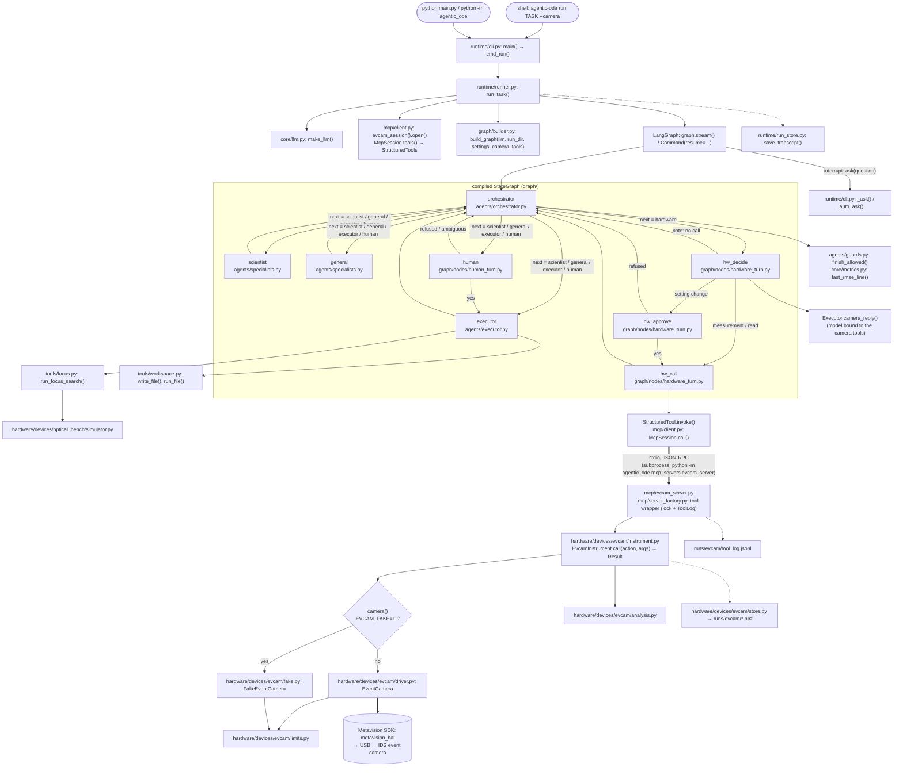

# Architecture

This is the layout after the refactor (branch `refactor/structure`). The plan and the order of the steps are in
[refactor-plan.md](refactor-plan.md). The map of the code before the refactor is in
[architecture-current.md](architecture-current.md). The behaviour did not change: the same CLI, the same MCP tools
(names, descriptions, schemas, results), the same prompts and the same graph. The snapshot tests in
`tests/test_refactor_snapshot.py` check this.

## 1. Folder tree

```
agentic_ode/
├── __init__.py              public names: Settings, build_graph, run_task, RunOutcome (the last three load lazily)
├── __main__.py              python -m agentic_ode → runtime.cli.main
├── core/                    shared basics; imports nothing from the rest of the project
│   ├── config.py            Settings (model, paths, limits) from the environment and .env; PROJECT_ROOT
│   ├── state.py             DialogueState, Turn, Role, SPECIALISTS, END_ROUTE, camera tool groups, initial_state
│   ├── records.py           RunRecord, ExperimentRecord, CameraRecord (real tool calls the finish guard trusts)
│   ├── dialogue.py          the dialogue as text: render_dialogue, role_label, decision_field, last_orchestrator_turn
│   ├── metrics.py           the FREE_RUN_TRAIN/TEST_RMSE output contract (regexes)
│   └── llm.py               make_llm, with_retry, text_of, ConfigurationError
├── agents/                  the four roles that call a model
│   ├── prompts.py           the system prompt of every role
│   ├── context.py           what a specialist sees: whole dialogue + latest instruction
│   ├── guards.py            finish_allowed (the finish guard), accepted (the yes rule), FINISH
│   ├── orchestrator.py      Decision, Orchestrator: one structured decision per turn
│   ├── specialists.py       scientist and general agent (one plain model call, no tools)
│   └── executor.py          Executor: tool loop over write_file, run_file, run_focus_search; holds the camera model
├── tools/                   the executor's in-process tools
│   ├── __init__.py          make_executor_tools (LangChain schemas), tool names
│   ├── workspace.py         write_file (new files only), run_file (subprocess with a time limit)
│   └── focus.py             run_focus_search on the simulated optical bench; images, JSON, CSV
├── graph/                   the LangGraph StateGraph
│   ├── __init__.py          build_graph
│   ├── builder.py           adds the 8 nodes and their edges, compiles with an in-memory checkpointer
│   ├── routing.py           route(), node names HW_DECIDE/HW_APPROVE/HW_CALL, note(), back_to_orchestrator()
│   └── nodes/
│       ├── human_turn.py    human: interrupt(), add the reply, route on yes/no
│       └── hardware_turn.py hw_decide (model picks ONE camera call), hw_approve (human), hw_call (runs it via MCP)
├── hardware/
│   ├── standard/            the Model Hardware Standard (§3): knows no device and no server
│   │   ├── instrument.py    Instrument (abstract class), ActionSpec, KINDS
│   │   ├── result.py        Result: the envelope {ok, result, error, warnings} and to_wire()
│   │   └── registry.py      instrument name → "module:attribute" factory, imported only by create()
│   └── devices/
│       ├── __init__.py      the list of known instruments (register(...) lines)
│       ├── evcam/           the IDS event camera
│       │   ├── events.py    EVENT_DTYPE: the event format (no SDK needed)
│       │   ├── driver.py    EventCamera: the real camera through the Metavision SDK (imported in open())
│       │   ├── fake.py      FakeEventCamera: the same methods, made-up events (scenes dark, pwm, steady)
│       │   ├── limits.py    safety limits and checks; sensor size, mask slots, 20 kHz pixel limit
│       │   ├── analysis.py  pure numpy: summary, hot pixels, flicker spectrum
│       │   ├── store.py     one .npz per recording in runs/evcam/, safe recording ids
│       │   └── instrument.py EvcamInstrument: the 10 actions on top of driver.py or fake.py
│       └── optical_bench/
│           └── simulator.py the HW2 bench: DMD, scattering medium, noisy camera, enhancement
├── mcp/                     everything that speaks MCP
│   ├── client.py            McpSession (one stdio server, one session in a background thread), evcam_session()
│   ├── server_factory.py    build_server(instrument, log) → FastMCP; ToolLog
│   ├── serve.py             python -m agentic_ode.mcp.serve NAME: any registered instrument over stdio
│   └── evcam_server.py      the evcam server object `mcp` = build_server(EvcamInstrument(), tool_log)
├── mcp_servers/
│   └── evcam_server.py      kept alias: `python -m agentic_ode.mcp_servers.evcam_server` (the documented command)
├── runtime/                 one run, from the command line to the saved files
│   ├── cli.py               agentic-ode run | report; asks the person when the graph pauses
│   ├── runner.py            run_task(): run folder, camera session, stream the graph, resume after pauses
│   └── run_store.py         transcript.json and transcript.md of a run
└── reporting/               solution.pdf from a finished run
    ├── builder.py           HTML + PDF (headless Chrome) from transcript.json
    └── diagram.py           draws the compiled graph (PNG) and returns its Mermaid text
```

Import direction (one way only):

```
runtime → graph → agents → tools, core
runtime → mcp/client                         (the agent side never imports hardware/)
mcp → hardware/standard, hardware/devices
hardware/devices → hardware/standard → nothing from the project
reporting → core, runtime/run_store, graph
```

## 2. Who calls whom: `agentic-ode run --camera` down to the camera

Solid arrow: a function call in the same process. Thick arrow: crosses a process boundary. Dotted arrow: reads or
writes files.



`agentic-ode report RUN_DIR`: `runtime/cli.cmd_report()` → `reporting/builder.build_report()`. That calls
`runtime/run_store.load_transcript()` and `reporting/diagram.graph_png()`, which calls `graph.build_graph()` with
a dummy model.

## 3. Model Hardware Standard: how to add a new instrument

An **instrument** is a device, real or simulated, seen as a list of **actions**. Each action becomes one MCP tool.
The standard has four parts in `hardware/standard/`, plus one generic server in `mcp/`.

| Part | File | What it is |
|---|---|---|
| `ActionSpec` | `instrument.py` | `name` (the tool name), `description` (the model reads it), `kind` (`"read"`, `"setting"` or `"measurement"`), and `handler`: a normal method with type hints that returns a `Result`. The type hints are the tool's JSON schema (`spec.input_schema`). |
| `Instrument` | `instrument.py` | Abstract class: `describe()` (static facts, at least `name` and `instructions`), `actions()` (list of `ActionSpec`, in tool order), `close()` (release the hardware), `call(action, args)` (runs the handler; any exception becomes `Result.failure("TypeName: message")`). |
| `Result` | `result.py` | The envelope `{ok, result, error, warnings}`. `to_wire()` makes the flat JSON the agent reads: `{"ok": true, **result, "warning": "a \| b"}` or `{"ok": false, "error": "..."}`. |
| registry | `registry.py` | `register(name, "module:attribute")`, `names()`, `create(name)`. The module is imported only by `create()`, so listing never loads an SDK. |
| server factory | `mcp/server_factory.py` | `build_server(instrument, ToolLog(path))` turns any Instrument into a FastMCP server: one tool per action, one lock, one JSON log line per call, `close()` when the server stops. fastmcp checks the argument types before an action runs. |

The kind tells what an action may do: a `"setting"` changes the device, so the agent asks the human first. A
successful `"measurement"` can finish a task. A `"read"` changes nothing.

### Example: the simulated optical bench from HW2

**Step 1.** Write `hardware/devices/optical_bench/instrument.py`:

```python
from agentic_ode.hardware.devices.optical_bench.simulator import Bench, enhancement, make_regions
from agentic_ode.hardware.standard import ActionSpec, Instrument, Result


class OpticalBenchInstrument(Instrument):
    name = "optical_bench"

    def __init__(self, macropixel: int = 8, seed: int = 0):
        self._bench = Bench(macropixel, seed)

    def describe(self) -> dict:
        return {"name": self.name, "instructions": "Simulated optical bench: laser -> DMD -> scattering medium -> "
                                                   "camera. Set a DMD pattern, take noisy camera shots."}

    def actions(self) -> list[ActionSpec]:
        return [ActionSpec("set_pattern", "Set the DMD macropixel pattern (0/1 per macropixel).", "setting",
                           self.set_pattern),
                ActionSpec("shot", "Take one noisy camera image and return the focus enhancement.", "measurement",
                           self.shot)]

    def set_pattern(self, pattern: list[int]) -> Result:
        if len(pattern) != self._bench.n:
            raise ValueError(f"pattern needs {self._bench.n} values, got {len(pattern)}")  # → ok false
        self._bench.set_pattern([p == 1 for p in pattern])
        return Result.success({"macropixels_on": sum(pattern)})

    def shot(self, focus_size: int = 2, n_background_regions: int = 8) -> Result:
        value = enhancement(self._bench.shot(), make_regions(focus_size, n_background_regions))
        return Result.success({"enhancement": round(value, 3)})
```

**Step 2.** Add one line to `hardware/devices/__init__.py`:

```python
registry.register("optical_bench", "agentic_ode.hardware.devices.optical_bench.instrument:OpticalBenchInstrument")
```

**Step 3.** Serve it and test it. Nothing in `mcp/` changes:

```bash
python -m agentic_ode.mcp.serve optical_bench          # stdio MCP server, log in runs/optical_bench/
```

In a test, use `build_server(OpticalBenchInstrument(), ToolLog(tmp_path / "log.jsonl"))` with fastmcp's in-memory
`Client`, or `McpSession(transport=...)`, the way `tests/test_hardware_standard.py` and `tests/test_mcp_serve.py`
do.

Rules for a new instrument:
- The method docstring is not used automatically: put the tool text in `ActionSpec.description`.
  `EvcamInstrument` uses `inspect.getdoc(handler)` so the text stays next to the code.
- Type hints must be JSON types (`int`, `float`, `str`, `bool`, `list[...]`, `tuple[...]`). A default value
  becomes the schema default.
- Raise an exception for a bad call; `call()` turns it into `{"ok": false, "error": "ValueError: ..."}`. Never
  return raw bulk data; save it and return an id, like `record()` does.
- Put warnings in `Result.warnings`, not in the result dict.

**Limit (not done yet, refactor Phase 3).** The agent side still knows only the event camera:
- `agents/prompts.py` has the camera prompt text;
- `core/state.py` names the camera's setting and measurement tools.

So a new instrument can be **served** without touching `mcp/` or `agents/`, but letting the **agent drive** it
needs Phase 3 of the plan: the tool kind sent in the MCP tool metadata, and the prompt notes sent as MCP prompts.

## 4. Notes

- `evcam_session()` still starts `python -m agentic_ode.mcp_servers.evcam_server`. A test pins this command, and
  it is the documented one. The alias runs `mcp/evcam_server.main()`.
- `EVCAM_FAKE` is read when the camera is first needed, not at import time.
- `agentic_ode/__init__.py` loads `build_graph`/`run_task` on first use. So the MCP server process and the camera
  scripts no longer load LangGraph and LangChain.
